## Sobre mim

Sou **AI Automation Engineer**. Construo agentes de IA, automações e aplicações para resolver problemas reais de negócio.

Trabalho com **n8n, LLMs (Claude, OpenAI e Gemini), APIs REST, webhooks, RAG e Supabase**. Uso **Claude Code** (skills, MCPs, hooks) para levar uma ideia até um produto funcionando. Para que um agente seja confiável, aplico **evals, validação de saída estruturada, gates de qualidade e revisão humana**.

Antes da tecnologia, trabalhei com vendas B2B e estruturação de operações comerciais. Por isso começo pelo processo: mapeio o fluxo com quem usa, priorizo o que gera retorno e só depois automatizo.

## O que eu construo

| Área | O que faço |
|---|---|
| **Agentes de IA** | Agentes de SDR para leads inbound e outbound: qualificação, lead score e abordagem multicanal, integrados ao CRM. |
| **Automações com n8n** | Workflows com webhooks, APIs, bancos de dados e LLMs, com tratamento de erro e etapas de revisão humana. |
| **RAG** | Respostas baseadas na base de conhecimento da empresa, sem depender só do que o modelo "sabe". |
| **Evals e qualidade** | Datasets de teste, métricas por campo e gates que bloqueiam a entrega quando a qualidade cai. |

## Projeto em destaque

### [nfse-extraction](https://github.com/analiceferreirads1/nfse-extraction)

Extrai seis campos de notas fiscais de serviço (NFS-e) em PDF. As regras determinísticas rodam primeiro. A IA (Gemini, com JSON Schema) só é chamada para os campos que faltaram, e toda resposta do modelo é validada antes de ser aceita. O que gerar dúvida vai para revisão humana.

Resultado da eval em 10 notas fictícias:

| Extrator | Acurácia | Tokens | Chamadas à IA |
|---|---|---|---|
| Só regras (linha de base) | 50% | 0 | 0 |
| Só IA | 100% | 4.714 | 12 |
| **Cascata (regras + IA)** | **100%** | **3.350** | **8** |

A cascata mantém a acurácia e gasta **29% menos tokens** que usar só a IA.

`TypeScript` `Vitest` `Gemini API` `JSON Schema` `Evals` `Proteção contra prompt injection`

## Stack

- **IA e agentes:** Claude · OpenAI · Gemini · RAG · Prompt engineering · Evals de LLM · Guardrails
- **Automação:** n8n · Webhooks · APIs REST · Supabase · CRMs (PipeRun, Pipedrive) · Apollo · Clay
- **Engenharia:** TypeScript · JavaScript · Node.js · React · Python (básico) · FastAPI · Docker · Git · Vitest
- **Desenvolvimento com IA:** Claude Code (skills, MCPs, hooks) · Spec Driven Development

## Formação

- **FlowGrammers**: Formação em Automações e Agentes de IA e Claude Code Engineering (2026, em andamento)
- **DevClub**: formação Full Stack (concluída em 2025)

## In English

AI Automation Engineer based in São Paulo, Brazil. I build AI agents, n8n automations and LLM applications (Claude, OpenAI, Gemini, RAG), with evals and quality gates so they can be trusted. Featured project: [nfse-extraction](https://github.com/analiceferreirads1/nfse-extraction), a rules-first, AI-fallback invoice extractor with an accuracy gate.

## Contato

[LinkedIn](https://www.linkedin.com/in/analiceferreirads) · [Portfólio](https://analiceferreira.com.br) · analiceferreirads12@gmail.com
